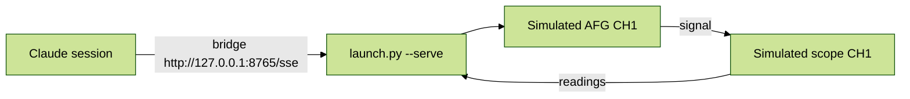

# tek-scope-afg-demo

## Summary
- A **simulated** Tektronix bench for a demo of the MHS plugin.
- A simulated AFG3000 (CH1) feeds a simulated MSO 4/5/6 scope (CH1).
- Claude can change the AFG settings and watch the scope's readings respond.
- No real hardware is touched.



## Status (as of 2026-10-20)
- All 9 slots are **simulated** (no real hardware). Startup checks: `VERIFY DONE failures=0` (twice), `drill failures=0`.
- Tested through the bridge: read slots, wrote all 6 controls, scope followed the AFG (10 kHz, 2 Vpp), a 6 Vpp write was refused (`> safe_max 5.0`), clipping at 0.1 V/div.
- After the startup emergency-stop drill, values stay at their stop values (1 Hz, 0.01 Vpp, scope stopped) until you change them.
- SDK: `~/python-sdk` (7c3f1d9e), bridge: `~/mhs-mcp-server` (0e26ea7), installed into `.venv`.

## Files
| File | What it does | Edit it to |
|---|---|---|
| `setup.yaml` | Lists every control and reading with its limits | Change limits or add slots |
| `rig_target.py` | The simulated AFG and scope | Change how the simulation behaves |
| `launch.py` | Starts everything (copied from the plugin; don't edit) | - |

## Reinstall (only if `.venv` is lost; Git Bash, Windows-style paths for uv)
```bash
cd ~/mhs_setups/tek-scope-afg-demo
uv pip install --python .venv/Scripts/python.exe -e "C:/Users/adm-u653647/python-sdk[inmem]" -e "C:/Users/adm-u653647/mhs-mcp-server" setuptools numpy
.venv/Scripts/python.exe launch.py --dry-run
```

## Start / stop / check (Git Bash)
- Start (tested): `cd ~/mhs_setups/tek-scope-afg-demo && nohup .venv/Scripts/python.exe launch.py --serve --estop-drill --port 8765 > serve.log 2>&1 & echo $! > serve.pid`
- Health check (tested): `curl -s -o /dev/null -m 2 -w "%{http_code}\n" http://127.0.0.1:8765/sse` (expect `200`)
- Stop (untested): `kill $(cat serve.pid)`
- Connect Claude (untested): `claude mcp add --transport sse tek-scope-afg-demo http://127.0.0.1:8765/sse`, then start a new session.
- Bridge tools: `read_slots`, `write_slots`, `emergency_stop`, `describe_setup`, `get_rig_snapshot`, `wait_for_condition`.
- Emergency stop clears only on restart (stop, then start again).

## Safety table
| Slot | Kind | Hardware limit | Allowed | On disconnect |
|---|---|---|---|---|
| afg/output_enable | control | 0-1 | 0-1 | HOLD (keeps state) |
| afg/frequency | control | 0.001 Hz-25 MHz | 1 Hz-25 MHz | SAFE (1 Hz) |
| afg/amplitude | control | 0.01-10 Vpp | 0.01-5 Vpp | SAFE (0.01 Vpp) |
| afg/waveform | control | 0-2 | 0-2 | SAFE (0 = sine) |
| scope/ch1_scale | control | 0.0005-10 V/div | 0.01-5 V/div | HOLD (keeps value) |
| scope/run | control | 0-1 | 0-1 | ZERO (stops) |
| scope/meas_frequency | reading | - | - | - |
| scope/meas_vpp | reading | - | - | - |
| scope/ch1_trace | reading | 1000 points | - | - |

- No interlocks (your choice, fine for a simulation).
- The emergency stop only resets the SAFE and ZERO slots. The two HOLD slots stay as they are.

## Open TODOs
- Moving to the real instruments needs a new hardware setup: real VISA/SCPI drivers, real addresses, and re-confirmed limits.
- The SDK warns that the `afg/output_enable` and `scope/ch1_scale` HOLD slots don't take part in the emergency stop. That's by your choice.

## Troubleshooting
- Log: `serve.log`. A healthy run shows `VERIFY DONE failures=0`, `drill failures=0`, then `SERVING`.
